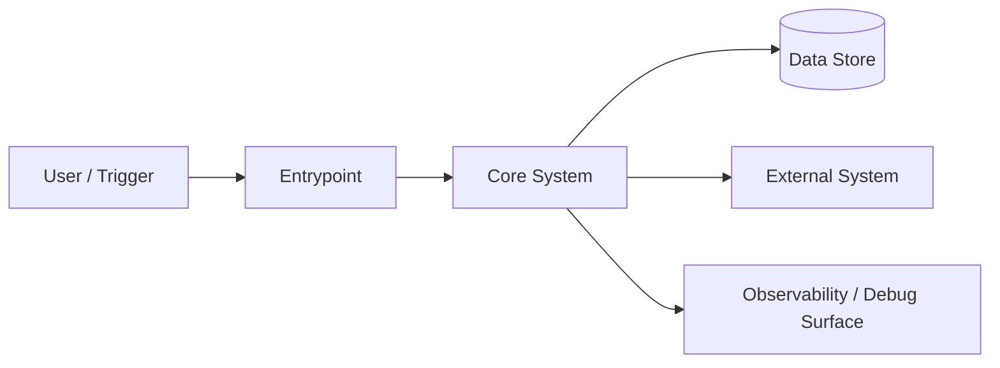
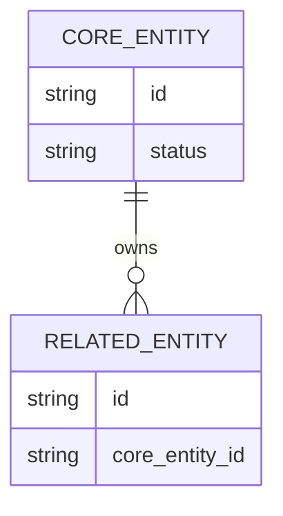
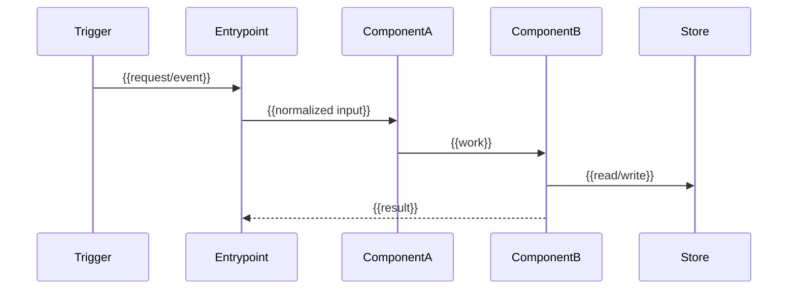

# {{SYSTEM_NAME}} Explanation

> Mode: Explain
> Status: Draft
> Owner: {{OWNER_OR_TEAM}}
> Last Updated: {{DATE}}
> Related Context: {{LINKS_OR_TICKETS}}

## 1. High-Level Overview

### What This System Is

{{Explain the system in plain language. Assume the reader is smart but has not read the code or prior context.}}

### Why It Exists

{{Explain the purpose, product/business/engineering problem, and why the system matters.}}

### High-Level Architecture

{{Describe the system at the highest useful level. Include a diagram by default when there are multiple actors, services, data stores, stages, or ownership boundaries.}}

### Core Concepts / Data Model

{{Define the key entities, state objects, events, records, queues, and terms. Include relationships and lifecycle where helpful.}}

### Mental Model

| # | Key Idea |
| --- | --- |
| 1 | {{Key idea that makes the system easier to understand}} |
| 2 | {{Key idea that makes the system easier to understand}} |
| 3 | {{Key idea that makes the system easier to understand}} |

## 2. Mid-Level System Walkthrough

### Components

#### Component: {{Component Name}}

| Field | Details |
| --- | --- |
| Responsibility | {{What this component owns}} |
| Inputs | {{Data/events/requests it receives}} |
| Outputs | {{Data/events/results it produces}} |
| Side Effects | {{External writes, network calls, notifications, jobs, mutations}} |
| Dependencies | {{Important upstream/downstream systems}} |
| Boundary | {{What this component should not know or own}} |
| Unit Test Plan | {{Unit tests or pure behavior checks that prove this component}} |
| Integration Test Plan | {{Cross-component, DB/API/job, logs, or traces that prove this component}} |
| E2E Test Plan | {{End-to-end workflow, replay, browser/API flow, or N/A with reason}} |
| Manual / Debug Verification | {{Dashboards, logs, screenshots, DB rows, or manual checks}} |

#### Component: {{Component Name}}

| Field | Details |
| --- | --- |
| Responsibility | {{What this component owns}} |
| Inputs | {{Data/events/requests it receives}} |
| Outputs | {{Data/events/results it produces}} |
| Side Effects | {{External writes, network calls, notifications, jobs, mutations}} |
| Dependencies | {{Important upstream/downstream systems}} |
| Boundary | {{What this component should not know or own}} |
| Unit Test Plan | {{Unit tests or pure behavior checks that prove this component}} |
| Integration Test Plan | {{Cross-component, DB/API/job, logs, or traces that prove this component}} |
| E2E Test Plan | {{End-to-end workflow, replay, browser/API flow, or N/A with reason}} |
| Manual / Debug Verification | {{Dashboards, logs, screenshots, DB rows, or manual checks}} |

### Runtime Flow

{{Explain how the system runs from trigger to output. Prefer a sequence/swimlane diagram first, then prose for edge cases.}}

### Important Behaviors

#### Happy Path

{{Describe the common path end to end.}}

#### Edge Cases / Failure Modes

{{Describe the confusing or high-risk paths, what fails open/closed, and what retries or recovery mechanisms exist.}}

#### Observability / Debugging

{{Describe logs, metrics, traces, dashboards, debug panels, database rows, and where to look during an incident.}}

## 3. Low-Level Code Map

### Where Things Live

- Entrypoints: {{files/functions/routes/jobs}}
- Core implementation: {{files/modules}}
- Source-of-truth types: {{files/models}}
- Persistence / external systems: {{tables/queues/apis}}
- Existing tests/fixtures: {{files}}
- Related docs: {{AGENTS.md/designs/runbooks}}

### Reading Guide

Start here:

| Order | Area | Why |
| --- | --- | --- |
| 1 | {{Best first file or doc}} | {{Why it gives the fastest orientation}} |
| 2 | {{Main orchestrator or entrypoint}} | {{What flow it shows}} |
| 3 | {{Core type/model file}} | {{What concepts it defines}} |
| 4 | {{Important test or fixture}} | {{What behavior it proves}} |

Then inspect:

| Area | What To Look For |
| --- | --- |
| {{Component or file cluster}} | {{What this explains}} |
| {{Component or file cluster}} | {{What this explains}} |
| {{Component or file cluster}} | {{What this explains}} |

### Review / Investigation Checklist

| Check | How To Verify |
| --- | --- |
| {{Question to ask when reviewing/debugging}} | {{Where/how to answer it}} |
| {{Invariant to verify}} | {{Expected signal}} |
| {{Metric/log/table to inspect}} | {{Expected signal}} |
| {{Test or replay to run}} | {{Expected result}} |

## Scope Of This Explanation

### Covered

| # | Topic |
| --- | --- |
| 1 | {{What this doc explains}} |
| 2 | {{What this doc explains}} |

### Not Covered

| # | Topic |
| --- | --- |
| 1 | {{What this doc intentionally leaves out}} |
| 2 | {{Adjacent system or deeper topic}} |

## Assumptions

| # | Assumption | Why Reasonable | If Wrong |
| --- | --- | --- | --- |
| 1 | {{Assumption}} | {{Reason}} | {{What changes in this explanation}} |
| 2 | {{Assumption}} | {{Reason}} | {{What changes in this explanation}} |

## Open Questions

### Product / Behavior

| Question | Implication | Importance |
| --- | --- | --- |
| {{Question}} | {{What changes depending on the answer}} | {{P0/P1/P2}} |
| {{Question}} | {{What changes depending on the answer}} | {{P0/P1/P2}} |

### Architecture / Boundaries

| Question | Implication | Importance |
| --- | --- | --- |
| {{Question}} | {{What changes depending on the answer}} | {{P0/P1/P2}} |
| {{Question}} | {{What changes depending on the answer}} | {{P0/P1/P2}} |

### Data / Contracts

| Question | Implication | Importance |
| --- | --- | --- |
| {{Question}} | {{What changes depending on the answer}} | {{P0/P1/P2}} |
| {{Question}} | {{What changes depending on the answer}} | {{P0/P1/P2}} |

### Operations / Debugging

| Question | Implication | Importance |
| --- | --- | --- |
| {{Question}} | {{What changes depending on the answer}} | {{P0/P1/P2}} |
| {{Question}} | {{What changes depending on the answer}} | {{P0/P1/P2}} |

### Testing / Verification

| Question | Implication | Importance |
| --- | --- | --- |
| {{Question}} | {{What changes depending on the answer}} | {{P0/P1/P2}} |
| {{Question}} | {{What changes depending on the answer}} | {{P0/P1/P2}} |

## Verification Plan

| Level | What To Validate | Notes |
| --- | --- | --- |
| Unit-Level | {{Tests or pure functions that validate component behavior}} | {{Expected signal}} |
| Integration | {{Tests, scripts, logs, or traces that validate component interaction}} | {{Expected signal}} |
| E2E / Replay | {{End-to-end flow, replay, browser/API flow, or N/A with reason}} | {{Expected signal}} |
| Manual Review | {{Screenshots, dashboards, database rows, config pages, or manual checks}} | {{Who/where/how}} |

## Iteration Notes

### Review First

| # | Item | Why It Matters |
| --- | --- | --- |
| 1 | {{Most uncertain explanation or assumption}} | {{Reason}} |
| 2 | {{Question that should be resolved next}} | {{Reason}} |

### Follow-Up Docs

| # | Doc |
| --- | --- |
| 1 | {{Deeper subsystem or adjacent workflow worth explaining separately}} |
| 2 | {{Design/spec that should be written if changes are proposed}} |
