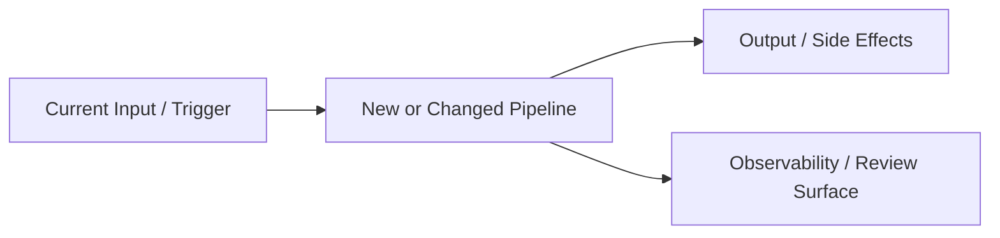
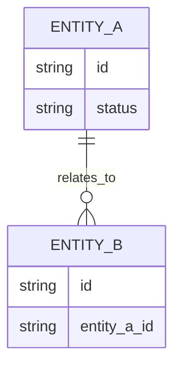
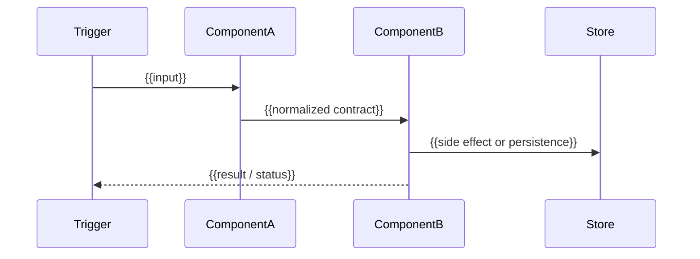

# {{SPEC_TITLE}} Spec

> Status: Draft
> Owner: {{OWNER_OR_TEAM}}
> Last Updated: {{DATE}}
> Related Context: {{LINKS_OR_TICKETS}}

## 1. High-Level Overview

### Goal

{{Explain the desired user/customer/system outcome in plain language. Keep this understandable to someone who has not read the code.}}

### Current State

{{Explain what exists today, what is painful or missing, and why this work is being considered now.}}

### Target Shape

{{Describe the proposed high-level architecture and lifecycle. Include a diagram by default when there are multiple stages, services, actors, data flows, or ownership boundaries.}}

### Data Model / Core Concepts

{{Describe the conceptual entities, state objects, records, events, or documents involved. Keep this conceptual unless the schema already exists.}}

### Intent

| # | Intent |
| --- | --- |
| 1 | {{Intent}} |
| 2 | {{Intent}} |
| 3 | {{Intent}} |

### Goals

| # | Goal |
| --- | --- |
| 1 | {{Concrete capability or behavior}} |
| 2 | {{Concrete capability or behavior}} |
| 3 | {{Concrete capability or behavior}} |

### Non-Goals

| # | Non-Goal |
| --- | --- |
| 1 | {{What this spec intentionally does not cover}} |
| 2 | {{What should not be solved in this iteration}} |

## 2. Mid-Level System Design

### Components

#### Component: {{Component Name}}

| Field | Details |
| --- | --- |
| Responsibility | {{What this component owns}} |
| Inputs | {{Data/events/requests it receives}} |
| Outputs | {{Data/events/results it produces}} |
| Side Effects | {{External writes, network calls, notifications, jobs, mutations}} |
| Owner / Boundary | {{Where ownership starts and ends; what it should not know about}} |
| Unit Test Plan | {{Pure behavior, edge cases, validation, mapping}} |
| Integration Test Plan | {{Interactions with DB/API/queues/services or adjacent components}} |
| E2E Test Plan | {{User workflow, replay, browser/API flow, or mark N/A with reason}} |

#### Component: {{Component Name}}

| Field | Details |
| --- | --- |
| Responsibility | {{What this component owns}} |
| Inputs | {{Data/events/requests it receives}} |
| Outputs | {{Data/events/results it produces}} |
| Side Effects | {{External writes, network calls, notifications, jobs, mutations}} |
| Owner / Boundary | {{Where ownership starts and ends; what it should not know about}} |
| Unit Test Plan | {{Pure behavior, edge cases, validation, mapping}} |
| Integration Test Plan | {{Interactions with DB/API/queues/services or adjacent components}} |
| E2E Test Plan | {{User workflow, replay, browser/API flow, or mark N/A with reason}} |

### Component Flow

{{Explain how components compose. Prefer a diagram first, then prose for edge cases.}}

### Key Behaviors

#### Success Path

{{Describe the happy path from trigger to final observable outcome.}}

#### Partial Failure / Retry / Idempotency

{{Describe what can fail, what retries, what must be idempotent, and what should be skipped or resumed.}}

#### Observability

{{Describe logs, metrics, traces, debug records, audit rows, dashboard surfaces, and review affordances.}}

#### Migration / Rollout Mode

{{Describe dual-run, shadowing, backfill, feature flags, canary, or cutover strategy if applicable.}}

## 3. Low-Level Code Map

### Where Things Live

- Entrypoints: {{files/functions/routes/jobs}}
- Source-of-truth types: {{files/models}}
- Existing helpers/adapters to reuse: {{files/functions}}
- Existing tests/fixtures: {{files}}
- Related docs: {{AGENTS.md/designs/runbooks}}

### Review Guide

Start review here:

| Order | Area | Why |
| --- | --- | --- |
| 1 | {{Primary entrypoint or top-level orchestrator}} | {{Why this is the best starting point}} |
| 2 | {{Core component or type definitions}} | {{What this clarifies}} |
| 3 | {{Side-effect boundary}} | {{What risk this contains}} |
| 4 | {{Tests / replay / fixtures}} | {{What behavior this verifies}} |

Review focus:

| Risk Area | What To Check |
| --- | --- |
| Correctness | {{Correctness risk}} |
| Compatibility | {{Compatibility risk}} |
| Observability / Debuggability | {{Observability/debuggability risk}} |
| Operations / Migration | {{Operational or migration risk}} |

### Known Touch Points

| Touch Point | Notes / Risk |
| --- | --- |
| {{Integration point or module}} | {{Why it matters}} |
| {{Integration point or module}} | {{Why it matters}} |
| {{Integration point or module}} | {{Why it matters}} |

## Scope

### In Scope

| # | Item |
| --- | --- |
| 1 | {{In-scope item}} |
| 2 | {{In-scope item}} |

### Out Of Scope

| # | Item |
| --- | --- |
| 1 | {{Out-of-scope item}} |
| 2 | {{Out-of-scope item}} |

### Success Metric

{{How we will know this spec/feature succeeded.}}

## Constraints And Principles

| Category | Constraint / Principle |
| --- | --- |
| Compatibility | {{Compatibility constraint}} |
| Decoupling / Composability | {{Decoupling/composability principle}} |
| Reliability / Idempotency | {{Reliability/idempotency principle}} |
| Observability / Debugging | {{Observability/debugging principle}} |
| Migration / Rollout | {{Migration/rollout principle}} |

## Open Questions

### Product / Behavior

| Question | Implication | Importance |
| --- | --- | --- |
| {{Question}} | {{What changes depending on the answer}} | {{P0/P1/P2}} |
| {{Question}} | {{What changes depending on the answer}} | {{P0/P1/P2}} |

### Data / Contracts

| Question | Implication | Importance |
| --- | --- | --- |
| {{Question}} | {{What changes depending on the answer}} | {{P0/P1/P2}} |
| {{Question}} | {{What changes depending on the answer}} | {{P0/P1/P2}} |

### Operations / Rollout

| Question | Implication | Importance |
| --- | --- | --- |
| {{Question}} | {{What changes depending on the answer}} | {{P0/P1/P2}} |
| {{Question}} | {{What changes depending on the answer}} | {{P0/P1/P2}} |

### Ownership / Boundaries

| Question | Implication | Importance |
| --- | --- | --- |
| {{Question}} | {{What changes depending on the answer}} | {{P0/P1/P2}} |
| {{Question}} | {{What changes depending on the answer}} | {{P0/P1/P2}} |

### Testing / Validation

| Question | Implication | Importance |
| --- | --- | --- |
| {{Question}} | {{What changes depending on the answer}} | {{P0/P1/P2}} |
| {{Question}} | {{What changes depending on the answer}} | {{P0/P1/P2}} |

## Assumptions

| # | Assumption | Why Reasonable | If Wrong |
| --- | --- | --- | --- |
| 1 | {{Assumption}} | {{Reason}} | {{What changes}} |
| 2 | {{Assumption}} | {{Reason}} | {{What changes}} |

## Testing Plan

| Level | What To Validate | Notes |
| --- | --- | --- |
| Unit | {{Component/function behavior to test}} | {{Edge case or invariant}} |
| Integration | {{Cross-component or DB/API/job interaction to test}} | {{Failure/retry/idempotency path}} |
| E2E / Replay | {{End-to-end workflow, replay scenario, or N/A with reason}} | {{Regression scenario}} |
| Manual QA / Review | {{Manual check, dashboard review, screenshot/browser validation, or operational review}} | {{Who/where/how}} |
| Observability / Rollout | {{Metric/log/trace/dashboard/alert to verify}} | {{Canary/backfill/shadow check}} |

## Iteration Notes

### Review First

| # | Item | Why It Matters |
| --- | --- | --- |
| 1 | {{Highest-risk decision or assumption}} | {{Reason}} |
| 2 | {{Question that should be answered before design/implementation}} | {{Reason}} |

### Moves To Design After Spec Lock

| # | Item |
| --- | --- |
| 1 | {{Detailed interface/schema/API work}} |
| 2 | {{Implementation plan / task breakdown}} |
